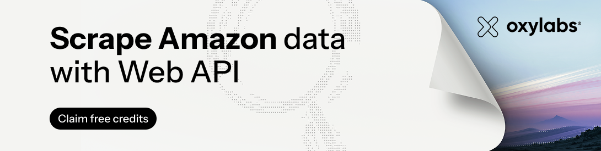

[](https://oxylabs.io/products/web-api/scrape/ecommerce/amazon) 

<a href="https://oxylabs.io"></a>
<a href="https://developers.oxylabs.io"></a>
<a href="https://dashboard.oxylabs.io"></a>
<a href="https://discord.gg/YOUR-INVITE"></a>
<a href="https://www.youtube.com/@oxylabs"></a>

# Amazon Scraper

- [What does an Amazon scraper do?](#what-does-an-amazon-scraper-do)
- [Free Amazon Scraper](#free-amazon-scraper)
  - [Prerequisites](#prerequisites)
  - [Installation](#installation)
  - [Retrieving the URL of an Amazon page to scrape](#retrieving-the-url-of-an-amazon-page-to-scrape)
  - [Scraping Amazon product data](#scraping-amazon-product-data)
  - [Retrieved data](#retrieved-data)
  - [Notes](#notes)
- [Scraping Amazon with Oxylabs Web API](#scraping-with-oxylabs-web-api)
  - [URL](#url)
  - [Search](#search)
  - [Product](#product)
  - [Offer listing](#offer-listing)
  - [Best Sellers](#best-sellers)
  - [Sellers](#sellers)
- [Practical use cases](#practical-use-cases)
- [Why choose Oxylabs](#why-choose-oxylabs)
- [FAQ](#faq)
- [Learn more](#learn-more) 
- [Contact us](#contact-us)

## What does an Amazon scraper do?

An Amazon scraper automatically collects publicly available data from Amazon pages, so you don't have to copy it by hand. Give it a URL, an ASIN, a search term or a seller ID, and it returns structured Amazon product data such as the title, price, ASIN and image URL.

This page covers two ways to scrape Amazon:

- **Free Amazon Scraper:** an open-source Python tool that saves Amazon product data from any department page to a CSV file. Best for small, one-off jobs.
- **Oxylabs Web API:** a managed service that handles proxy rotation, request management and parsing, and returns real-time structured data from Amazon at scale.

## Free Amazon Scraper

A free tool used to get Amazon product data for any provided Amazon department page.

### Prerequisites

To run this tool, you need to have Python 3.11 installed in your system.

### Installation

Open up a terminal window, navigate to this repository and run this command:

```bash
make install
```

### Retrieving the URL of an Amazon page to scrape

First off, open up Amazon and select a department from which you want to scrape.

For this example, we'll be using the Computers & Accessories department.


After the page loads, simply copy the URL in the browser and save it. We'll need it for scraping product data for that department.

### Scraping Amazon product data

To get data for products listed on the department page you chose, simply run this command in your terminal:

```bash
make scrape URL="<amazon_department_page_url>"
```

With the URL we retrieved earlier, the command would look like this:

```bash
make scrape URL="https://www.amazon.com/s?i=specialty-aps&bbn=16225009011&rh=n%3A%2116225009011%2Cn%3A541966&ref=nav_em__nav_desktop_sa_intl_computers_and_accessories_0_2_5_6"
```

Make sure to surround the URL with quotation marks, otherwise the tool might have trouble parsing it.

After running the command, your terminal should look something like this:


If a listed product is out of stock, the tool will notify you with a message, as shown above.

### Retrieved data

After the tool has finished running, you should see a file named amazon_products.csv in your directory.

The generated CSV file contains data with these columns inside it:

- `title` - The title of the product.
- `url` - The URL pointing to the product's Amazon page.
- `asin_code` - The product's unique ASIN code.
- `image_url` - The URL of the image that contains the product.
- `price` - The price of the product. This field can be empty, if the product is out of stock.

The data should look something like this:


### Notes

In case the code doesn't work or your project is of bigger scale, please refer to the second part of the tutorial. There, we showcase how to scrape public data with Oxylabs Web API.

## Scraping with Oxylabs Web API

Alternatively, you can use Oxylabs Amazon Scraper API (part of [Web API](https://oxylabs.io/products/web-api/scrape/ecommerce/amazon)) to get publicly-available data from any page on Amazon (pricing, product information, etc.) with simple API requests.

This all-in-one solution is designed to handle Amazon's automated request management systems via fast-adapting infrastructure, which automates proxy rotation, web access management, and parsing to get real-time structured data. To start scraping any public website at scale, create a free account and claim $5 welcome credit [here](https://dashboard.oxylabs.io/).

Each Amazon target has its own endpoint under `https://webapi.oxylabs.io/v1/scrape/amazon`. Send your API key in the `Authorization` header, put the ASIN, search term or URL in the payload, and set `output` to `["json"]` to get parsed fields instead of raw HTML. Every endpoint works in sync, async and batch modes.

The example below requests the Amazon product page for ASIN B0935DN1BN from the German marketplace (amazon.de), with delivery location 10115 and prices in EUR:

```python
import requests
from pprint import pprint


# Structure payload.
payload = {
    'query': 'B0935DN1BN',
    'domain': 'de',
    'location': '10115',
    'currency': 'EUR',
    'output': ['json'],
}

# Get response.
response = requests.post(
    'https://webapi.oxylabs.io/v1/scrape/amazon/product',
    headers={'Authorization': 'Bearer YOUR_API_KEY'},  # Your API key goes here
    json=payload,
)

# Print prettified response to stdout.
pprint(response.json())
```

Here is a quick overview of all the available endpoints we support with Amazon:

| Endpoint.                       | Description                                             | Structured data    |
| ------------------------------- | ------------------------------------------------------- | ------------------ |
| `/v1/scrape/amazon`             | Submit any Amazon URL you like.                         | Depends on the URL |
| `/v1/scrape/amazon/bestsellers` | List of best seller items in a category of your choice. | Yes                |
| `/v1/scrape/amazon/pricing`     | List of offers available for an ASIN of your choice.    | Yes                |
| `/v1/scrape/amazon/product`     | Product page of an ASIN of your choice.                 | Yes                |
| `/v1/scrape/amazon/search`      | Search results for a search term of your choice.        | Yes                |
| `/v1/scrape/amazon/sellers`.    | Seller information of a seller of your choice.          | Yes                |

Besides the target-specific parameters in the sections below, every Amazon endpoint accepts these common parameters. See the full [Amazon API reference](https://developers.oxylabs.io/api-reference/dedicated-scrapers/commerce-scrapers#amazon) for details.

| Parameter.      | Description                                | Type           |
| --------------- | ------------------------------------------ | -------------- |
| `output`        | Formats to return: `markdown`, `html`, `json`, `screenshot`. Default `["html"]`. `json` returns parsed fields. `screenshot` requires `run_js: true`. | array of strings |
| `json`          | Custom extraction: `{"prompt": string}` or `{"schema": object}`, never both. Overrides the built-in parser. | object |
| `location`      | Delivery postal code, e.g. `10115`. Must belong to the marketplace set by `domain`. | string |
| `device`        | `desktop` (default) or `mobile`. | string |
| `run_js`        | Executes page JavaScript before capture. Slower, so use a client timeout of 150 seconds or more. | boolean |
| `callback_url`  | Webhook URL for the finished job. Async only. | string |
| `storage`       | Delivers the result to a bucket instead of the response: `{"type": string, "url": string}`. `type` is `s3`, `s3_gzip`, `s3_compatible`, `gcs` or `tos`. Async only. | object |

### URL

The `/v1/scrape/amazon` endpoint is designed to retrieve the content from various Amazon URLs. Instead of sending multiple parameters, you can provide us with a direct URL to the required Amazon page. Send it unchanged, because query string parameters select the variant and price.

**Query parameters**

| Parameter | Description | Type |
| --- | --- | --- |
| <mark style="background-color:green;">**`url`**</mark>* | A URL on any Amazon marketplace. Send it unchanged: query string parameters select the variant and price. | string |
| `autoselect_variant` | Follows the listing's default variant instead of returning the bare parent listing. Set when a parent ASIN returns no price. | boolean |
| `check_empty_geo` | Fails the request instead of returning content that ignored location. | boolean |
| `currency` | Currency to report prices in, e.g. `EUR`. | string |
| `locale` | Interface language, e.g. `en_US`. | string |

/* required parameter

The endpoint also accepts the common parameters above and the search filters listed under Search.

**Python code example**

In the code example below, we make a request to retrieve the Amazon product page for B0BDJ279KF.

```python
import requests
from pprint import pprint


# Structure payload.
payload = {
    'url': 'https://www.amazon.co.uk/dp/B0BDJ279KF',
    'output': ['json'],
}

# Get response.
response = requests.post(
    'https://webapi.oxylabs.io/v1/scrape/amazon',
    headers={'Authorization': 'Bearer YOUR_API_KEY'},  # Your API key goes here
    json=payload,
)

# Print prettified response to stdout.
pprint(response.json())
```

### Search

The `/v1/scrape/amazon/search` endpoint is designed to retrieve Amazon search result pages, with paid placements marked.

**Query parameters**

| Parameter | Description | Type |
| --- | --- | --- |
| <mark style="background-color:green;">**`query`**</mark>* | Search keyword. | string |
| `category_id` | Restricts to an Amazon browse node. | string |
| `check_empty_geo` | Fails the request instead of returning content that ignored location. | boolean |
| `currency` | Currency to report prices in, e.g. `EUR`. | string |
| `domain` | Marketplace TLD: `com`, `de`, `co.uk`, `co.jp`. | string |
| `locale` | Interface language, e.g. `en_US`. | string |
| `max_price` | Highest price to include, in the marketplace's currency. | integer |
| `merchant_id` | Restricts to one seller's items. | string |
| `min_price` | Lowest price to include, in the marketplace's currency. | integer |
| `pages` | Consecutive pages to fetch from `start_page`. Each page is a separate fetch and charge. | integer |
| `refinements` | Amazon's filter facets: brand, rating, Prime eligibility. Forwarded verbatim; values differ per marketplace. | array of strings |
| `safe_search` | Amazon's content filter. | boolean |
| `sort_by` | Amazon's own sort key, e.g. `price-asc-rank`, `review-rank`. Forwarded verbatim; values differ per marketplace. | string |
| `start_page` | First results page. Default 1. | integer |

/* required parameter

**Python code example**

In the code example below, we search the amazon.nl marketplace for "adidas", retrieving 10 pages of results starting from page 11, filtered by browse node 16391843031 and seller 3AA17D2BRD4YMT0X.

```python
import requests
from pprint import pprint


# Structure payload.
payload = {
    'query': 'adidas',
    'domain': 'nl',
    'start_page': 11,
    'pages': 10,
    'category_id': '16391843031',
    'merchant_id': '3AA17D2BRD4YMT0X',
    'output': ['json'],
}

# Get response.
response = requests.post(
    'https://webapi.oxylabs.io/v1/scrape/amazon/search',
    headers={'Authorization': 'Bearer YOUR_API_KEY'},  # Your API key goes here
    json=payload,
)

# Print prettified response to stdout.
pprint(response.json())
```

### Product

The `/v1/scrape/amazon/product` endpoint is designed to retrieve Amazon product pages, including the product's title, price, availability, rating, images and variants.

**Query parameters**

| Parameter | Description | Type |
| --- | --- | --- |
| <mark style="background-color:green;">**`query`**</mark>* | ASIN, e.g. `B0935DN1BN`. Not a URL or title. | string |
| `autoselect_variant` | Follows the listing's default variant instead of returning the bare parent listing. Set when a parent ASIN returns no price. | boolean |
| `check_empty_geo` | Fails the request instead of returning content that ignored location. | boolean |
| `currency` | Currency to report prices in, e.g. `EUR`. | string |
| `domain` | Marketplace TLD: `com`, `de`, `co.uk`, `co.jp`. | string |
| `locale` | Interface language, e.g. `en_US`. | string |
| `safe_search` | Amazon's content filter. | boolean |

/* required parameter

**Python code example**

In the code example below, we make a request to retrieve the product page for ASIN B09RX4KS1G on the amazon.nl marketplace. If the ASIN provided is a parent ASIN, `autoselect_variant` makes the scraper follow the listing's default variant.

```python
import requests
from pprint import pprint


# Structure payload.
payload = {
    'query': 'B09RX4KS1G',
    'domain': 'nl',
    'autoselect_variant': True,
    'output': ['json'],
}

# Get response.
response = requests.post(
    'https://webapi.oxylabs.io/v1/scrape/amazon/product',
    headers={'Authorization': 'Bearer YOUR_API_KEY'},  # Your API key goes here
    json=payload,
)

# Print prettified response to stdout.
pprint(response.json())
```

### Offer listing

The `/v1/scrape/amazon/pricing` endpoint is designed to retrieve Amazon product offer listings, returning every offer on a listing from all sellers and conditions.

**Query parameters**

| Parameter | Description | Type |
| --- | --- | --- |
| <mark style="background-color:green;">**`query`**</mark>* | ASIN whose offers to return. | string |
| `check_empty_geo` | Fails the request instead of returning content that ignored location. | boolean |
| `condition` | Offer condition to return, e.g. `used`. | string |
| `currency` | Currency to report prices in, e.g. `EUR`. | string |
| `domain` | Marketplace TLD: `com`, `de`, `co.uk`, `co.jp`. | string |
| `locale` | Interface language, e.g. `en_US`. | string |
| `pages` | Consecutive pages to fetch from `start_page`. Each page is a separate fetch and charge. | integer |
| `safe_search` | Amazon's content filter. | boolean |
| `start_page` | First results page. Default 1. | integer |

/* required parameter

**Python code example**

In the code example below, we make a request to retrieve the product offer listing page for ASIN B09RX4KS1G on the amazon.nl marketplace.

```python
import requests
from pprint import pprint


# Structure payload.
payload = {
    'query': 'B09RX4KS1G',
    'domain': 'nl',
    'output': ['json'],
}

# Get response.
response = requests.post(
    'https://webapi.oxylabs.io/v1/scrape/amazon/pricing',
    headers={'Authorization': 'Bearer YOUR_API_KEY'},  # Your API key goes here
    json=payload,
)

# Print prettified response to stdout.
pprint(response.json())
```

### Best Sellers

The `/v1/scrape/amazon/bestsellers` endpoint is designed to retrieve Amazon Best Sellers pages, returning the bestseller ranking for a category.

**Query parameters**

| Parameter | Description | Type |
| --- | --- | --- |
| <mark style="background-color:green;">**`query`**</mark>* | Category or department name. Example: Clothing, Shoes & Jewelry. | string |
| `category_id` | Restricts to an Amazon browse node. | string |
| `check_empty_geo` | Fails the request instead of returning content that ignored location. | boolean |
| `currency` | Currency to report prices in, e.g. `EUR`. | string |
| `domain` | Marketplace TLD: `com`, `de`, `co.uk`, `co.jp`. | string |
| `locale` | Interface language, e.g. `en_US`. | string |
| `pages` | Consecutive pages to fetch from `start_page`. Each page is a separate fetch and charge. | integer |
| `safe_search` | Amazon's content filter. | boolean |
| `start_page` | First results page. Default 1. | integer |

/* required parameter

**Python code example**

In the code example below, we retrieve page 2 of the Best Sellers list for the "automotive" department, in browse node 82400031, on the amazon.de marketplace.

```python
import requests
from pprint import pprint


# Structure payload.
payload = {
    'query': 'automotive',
    'domain': 'de',
    'start_page': 2,
    'category_id': '82400031',
    'output': ['json'],
}

# Get response.
response = requests.post(
    'https://webapi.oxylabs.io/v1/scrape/amazon/bestsellers',
    headers={'Authorization': 'Bearer YOUR_API_KEY'},  # Your API key goes here
    json=payload,
)

# Print prettified response to stdout.
pprint(response.json())
```

### Sellers

The `/v1/scrape/amazon/sellers` endpoint is designed to retrieve Amazon Sellers pages, returning a seller's storefront.

**Query parameters**

| Parameter | Description | Type |
| --- | --- | --- |
| <mark style="background-color:green;">**`query`**</mark>* | Seller ID, e.g. `ABNP0A7Y0QWBN`. | string |
| `check_empty_geo` | Fails the request instead of returning content that ignored location. | boolean |
| `currency` | Currency to report prices in, e.g. `EUR`. | string |
| `domain` | Marketplace TLD: `com`, `de`, `co.uk`, `co.jp`. | string |
| `locale` | Interface language, e.g. `en_US`. | string |
| `safe_search` | Amazon's content filter. | boolean |

/* required parameter

**Python code example**

In the code example below, we make a request to retrieve the seller page for seller ID ABNP0A7Y0QWBN on the amazon.de marketplace.

```python
import requests
from pprint import pprint


# Structure payload.
payload = {
    'query': 'ABNP0A7Y0QWBN',
    'domain': 'de',
    'output': ['json'],
}

# Get response.
response = requests.post(
    'https://webapi.oxylabs.io/v1/scrape/amazon/sellers',
    headers={'Authorization': 'Bearer YOUR_API_KEY'},  # Your API key goes here
    json=payload,
)

# Print prettified response to stdout.
pprint(response.json())
```

## Practical use cases

Amazon data supports pricing, research and brand decisions. Each use case below maps to one or more of the endpoints above.

| Use case | What you collect | Endpoint to use |
| --- | --- | --- |
| Price monitoring and dynamic pricing | Current prices and competing offers for your ASINs | `/product`, `/pricing` |
| Competitor and seller analysis | Seller details and the listings competitors run | `/sellers`, `/search` |
| Market and product research | Best sellers per category and search rankings | `/bestsellers`, `/search` |
| Rating and brand reputation monitoring | Product ratings and listing details | `/product` |
| Catalog enrichment | ASINs, titles, images and product details | `/product`, the free Amazon scraper |

## Why choose Oxylabs

Oxylabs Web API is built so you can scrape Amazon without maintaining scrapers, proxies or parsers.

- **Pay for results, not attempts:** you pay only for successfully delivered results, with Amazon requests starting from $0.50 per 1,000 results ([see pricing](https://oxylabs.io/products/web-api/scrape/pricing)).
- **Any Amazon marketplace:** get localized Amazon data from any marketplace, with proxies in 195 countries.
- **Built-in proxy management:** a 177M+ rotating proxy pool, so you don't manage IPs yourself.
- **Access handled for you:** CAPTCHA handling, JavaScript rendering and AI-driven fingerprinting are included.
- **Flexible output and delivery:** choose JSON, Markdown, HTML or a screenshot, and get results in the response or in your own cloud storage bucket.
- **Agent-ready:** connect directly to your AI agents with MCP support and Agent Skills.
- **Support around the clock:** 24/7 support, trusted by 15,000+ clients globally.

## FAQ

### Is it legal to scrape Amazon?

Scraping publicly available data is generally allowed, but the answer depends on your jurisdiction, the type of data you collect and how you use it. Respect Amazon's terms, avoid personal data and get legal advice for your specific project.

### What data can I scrape from Amazon?

You can collect public product data such as titles, prices, ASINs, images, offers, seller information and best seller lists. The free Amazon scraper returns title, URL, ASIN, image URL and price. The Web API returns structured JSON for product pages, search results, offers, sellers and best sellers, and can fetch any other Amazon page from its URL.

### Should I use the free Amazon scraper or the Web API?

Use the free tool for small, one-off jobs on a single department page. Choose the Oxylabs Web API when you need larger volumes, multiple marketplaces or reliable access without managing proxies.

### How does the Web API deal with CAPTCHAs and blocks?

The Web API handles CAPTCHAs, JavaScript rendering and proxy rotation for you, and uses AI-driven fingerprinting to improve success rates, so you send a request and get the result back.

### Which Amazon marketplaces can I scrape?

Set the `domain` parameter to choose a marketplace, such as `com`, `de`, `co.uk` or `co.jp`, and use `location` to set the delivery postal code. See the [Amazon API reference](https://developers.oxylabs.io/api-reference/dedicated-scrapers/commerce-scrapers#amazon) for all parameters.

## Learn more

Check out our list of [Best Web Scraping Tools](https://oxylabs.io/blog/best-free-web-scrapers).

Looking to scrape more Amazon data? Try these guides:

- [Amazon ASIN Scraper](https://github.com/oxylabs/amazon-asin-scraper)
- [Handle Amazon CAPTCHA](https://github.com/oxylabs/how-to-bypass-amazon-captcha)
- [How to Scrape Amazon Prices](https://github.com/oxylabs/how-to-scrape-amazon-prices)
- [Scraping Amazon Product Data](https://github.com/oxylabs/how-to-scrape-amazon-product-data)

### Featured in Technical Communities

We're excited to see that our content and tools are being referenced by developers and technical writers across platforms!

- [How To Web Scrape Amazon Using Python](https://medium.com/@simon.dalton.349/how-to-web-scrape-amazon-df92ddf11fc9)
- [How to Handle Amazon CAPTCHA When Scraping](https://medium.com/@lambert.watts.809/how-to-bypass-amazon-captcha-when-scraping-fec20546abf9)
- [Best 10 Free Proxy Providers in 2025](https://medium.com/@lambert.watts.809/best-10-free-proxy-providers-dd78cd93fc04)

## Contact us

- **Email:** [support@oxylabs.io](mailto:support@oxylabs.io)
- **Live chat:** drop a message in the live chat, accessible via the [Oxylabs Dashboard](https://dashboard.oxylabs.io/en/)
- **Community:** join us on [Discord](https://discord.gg/Pds3gBmKMH), watch on [YouTube](https://www.youtube.com/@oxylabs) and follow Oxylabs on [GitHub](https://github.com/oxylabs)
